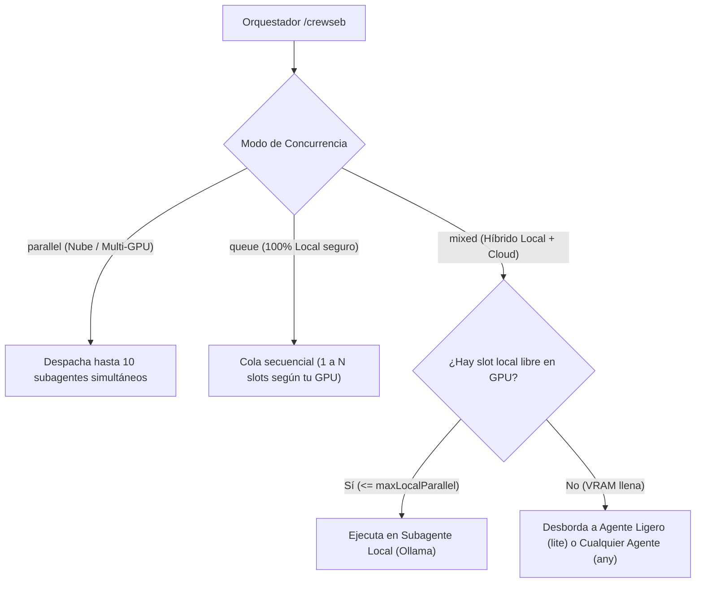

# crewseb

Una tripulación de **10 subagentes especialistas** con **nombres propios aleatorios**, reglas de ingeniería compartidas y delegación automática para **Antigravity CLI (`agy`)**, **Claude Code**, **Codex** y **OpenCode**.

Se conecta y registra automáticamente en [**hubseb**](https://github.com/PahesebPJ/hubseb) y se integra con la bóveda de memoria de [**memoseb**](https://github.com/PahesebPJ/memoseb).

## Qué incluye

- **10 Subagentes Especialistas** (`researcher`, `analyst`, `architect`, `developer`, `qa-automation`, `devops`, `sre`, `security`, `code-reviewer`, `documenter`).
- **Motor de Identidades Aleatorias (`Persona Engine`)**: Cada subagente tiene su rol técnico fijo, pero recibe un **nombre propio aleatorio** único (ej. `🛠️ [Kael · developer]`, `🔍 [Lyra · researcher]`). Puedes ver tu tripulación actual con `crewseb roster` o sortear nuevos nombres con `crewseb reroll`.
- **Perfiles de Modelos y Protección de GPU (`GPU Guard`)**: Soporta configuraciones listas para usar (`default`, `lite`, `hard`, `hybrid`, `ollama`, `cloud-tiered`) o personalizadas (`custom`), junto con detección automática de VRAM (`crewseb gpu`) y control de concurrencia local (`parallel`, `queue`, `mixed`).
- **6 Convenciones Modulares (`@include`)**: `handoff` (entrega máxima de 15 líneas), `branch` (worktrees aislados), `stack-node`, `stack-terraform`, `ci` y `observability`.
- **Reglas Globales (`rules/RULES.md`)**: Se inyectan firmadas con SHA-256 en la memoria global de cada agente.
- **Orquestador `/crewseb`**: Encadena automáticamente a la tripulación según el tipo de tarea (Feature, Bug, Infraestructura, Incidente o Revisión).

## Instalación (Para Humanos o Agentes de IA)

### Vía npm (Recomendado)

```sh
npm install -g crewseb
crewseb setup
```

### Desde código fuente (Desarrollo local)

```sh
git clone https://github.com/PahesebPJ/crewseb.git
cd crewseb
npm install
npm run build
crewseb setup
```

`crewseb setup` registra el nodo `crewseb` en la topología de `hubseb` (`~/.config/hubseb/topology.json`), sortea o carga los nombres de tu tripulación y los instala en los agentes que encuentre en tu máquina (`--agents claude,antigravity` elige cuáles, `--agents all` fuerza los 4).

## Comandos CLI

Todos los comandos aceptan `--json` para responder bajo el sobre estándar `hubseb/v1`.

```sh
crewseb setup [--agents a,b|all]                              # Registra en hubseb e instala en los agentes detectados
crewseb roster [--json]                                       # Muestra los 10 especialistas y sus nombres aleatorios actuales
crewseb reroll [rol] [--json]                                 # Sortea nuevos nombres (todos o un rol) y sincroniza
crewseb gpu [--json]                                          # Detecta tu GPU/VRAM y muestra cuántos agentes locales simultáneos soporta
crewseb models [--json]                                       # Muestra perfil activo, modo de concurrencia, GPU y matriz de modelos
crewseb models preset <default|lite|hard|hybrid|ollama|cloud-tiered> # Aplica un perfil de modelos preconfigurado
crewseb models concurrency <parallel|queue|mixed> [opciones]  # Configura cómo se ejecutan los subagentes locales para cuidar tu VRAM
crewseb models set <rol> <modelo> [--host <host>]             # Fija un modelo personalizado para un rol (perfil custom)
crewseb models set-tier <fast|balanced|deep> <modelo> [--host <host>] # Fija el modelo de un tier de razonamiento (perfil custom)
crewseb models reset [rol] [--host <host>]                    # Restaura la configuración de modelos por defecto
crewseb budget [--json]                                       # Verifica el presupuesto de tokens/caracteres de toda la tripulación
crewseb check [--json]                                        # Verifica la integridad SHA-256 de las directivas en cada host
crewseb uninstall [--json]                                    # Purga subagentes, reglas, skills y desconecta el nodo de hubseb
```

## La Tripulación (10 Roles)

| Icono | Rol | Tier Base | Qué hace | Herramientas |
|---|---|---|---|---|
| 🔍 | `researcher` | `balanced` | Verifica supuestos cruzando mínimo 2 fuentes antes de planear | lectura, Bash, web |
| 📋 | `analyst` | `balanced` | Historias de usuario, alcance y criterios Given/When/Then | lectura, Bash |
| 🏛️ | `architect` | `deep` | Diseño de soluciones, comparación de alternativas y diagramas Mermaid/ADR | lectura, Bash, web |
| 🛠️ | `developer` | `deep` | Implementa features o bugfixes acotados en su worktree con pruebas y gate | todas |
| 🧪 | `qa-automation` | `balanced` | Matriz de pruebas y tests unitarios, integración y e2e (Playwright) | todas |
| 🚀 | `devops` | `balanced` | Terraform por manifests, OIDC, GitLab CI y GitHub Actions | todas |
| 📡 | `sre` | `balanced` | Incidentes, logs, métricas, causa raíz y runbooks | lectura, Bash, web |
| 🛡️ | `security` | `deep` | Auditoría de IAM, red, secretos, código y dependencias con escenario real | lectura, Bash, web |
| 👁️ | `code-reviewer` | `deep` | Revisión de diff o MR antes de mezclar (separa «bloquea» de «sugerencia») | lectura, Bash |
| 📚 | `documenter` | `balanced` | README, documentación técnica y runbooks verificados contra el código | lectura, escritura, Bash |

## Tipos de Configuración de Modelos (`crewseb models preset`)

`crewseb` guarda tu configuración en `~/.config/seb/crewseb-models.json` (o `CREWSEB_MODELS_FILE`) y recompila/redespliega automáticamente los 10 especialistas en todos los hosts detectados.

| Perfil (`preset`) | Objetivo | Antigravity (`agy`) | Claude Code | Codex | OpenCode |
|---|---|---|---|---|---|
| **`default`** | Configuración estándar inicial | `inherit` | `sonnet` (`balanced`) / `opus` (`deep`) | `inherit` | `inherit` |
| **`lite`** | Máximo ahorro de tokens y velocidad (`fast` en todos los tiers) | `flash_lite` | `haiku` | `o4-mini` | `anthropic/claude-haiku-4-5` |
| **`hard`** | Máxima capacidad y razonamiento profundo (`deep` en todos los tiers) | `pro` | `opus` | `o3` | `anthropic/claude-opus-4-5` |
| **`hybrid`** | Mixto: modelos locales (`fast`/`balanced`) + modelos ligeros en nube (`deep` / `agy`) | `flash_lite` | Local (`7b`/`14b`) + `haiku` en `deep` | Local (`7b`/`14b`) + `o4-mini` en `deep` | Local (`7b`/`14b`) + `claude-haiku-4-5` en `deep` |
| **`ollama`** | 100% subagentes locales con Ollama por tier | `inherit` (fallback) | `qwen2.5-coder:7b` / `14b` / `deepseek-r1:32b` | `ollama/qwen2.5-coder:7b` / `14b` / `deepseek-r1:32b` | `ollama/qwen2.5-coder:7b` / `14b` / `deepseek-r1:32b` |
| **`cloud-tiered`** | Escalonado completo en la nube según tier (`fast` / `balanced` / `deep`) | `flash_lite` / `flash` / `pro` | `haiku` / `sonnet` / `opus` | `o4-mini` / `gpt-5.4` / `o3` | `claude-haiku-4-5` / `sonnet-4-5` / `opus-4-5` |
| **`custom`** | Personalización libre por rol (`set`) o por tier (`set-tier`) | Según override | Según override | Según override | Según override |

### Detalles de cada Configuración

1. **Configuración `default` (Estándar):**
   Mantiene la configuración base de cada agente (`sonnet` para roles `balanced` y `opus` para roles `deep` en Claude Code; `inherit` en Antigravity, Codex y OpenCode para heredar el modelo activo de tu sesión).
   ```sh
   crewseb models preset default
   ```

2. **Configuración `lite` (Ahorro de tokens):**
   Fuerza modelos ligeros y económicos en **todos** los roles y niveles de razonamiento (`flash_lite`, `haiku`, `o4-mini`, `anthropic/claude-haiku-4-5`). Ideal para tareas rápidas, exploración o presupuestos ajustados.
   ```sh
   crewseb models preset lite
   ```

3. **Configuración `hard` (Modelos pesados / frontera):**
   Fuerza modelos de razonamiento profundo en **todos** los roles y niveles (`pro`, `opus`, `o3`, `anthropic/claude-opus-4-5`). Ideal para arquitectura compleja, auditorías críticas de seguridad o refactorizaciones masivas.
   ```sh
   crewseb models preset hard
   ```

4. **Configuración `hybrid` / `custom` (Mixta: modelos locales + modelos lite):**
   Combina subagentes locales en los tiers `fast` y `balanced` (por defecto `ollama/qwen2.5-coder:7b` y `ollama/qwen2.5-coder:14b`) con modelos ligeros en la nube para `deep` y Antigravity (`flash_lite`, `haiku`, `o4-mini`, `anthropic/claude-haiku-4-5`). Además, activa automáticamente el modo de concurrencia **`mixed`** (respetando el límite de tu GPU y desbordando a modelos `lite`).
   ```sh
   # Activar perfil híbrido (local + lite)
   crewseb models preset hybrid

   # Personalizar qué modelo local o lite usar en el perfil híbrido
   crewseb models preset hybrid --local-model ollama/qwen2.5-coder:14b --lite-model haiku

   # O crear una configuración 100% personalizada (custom) combinando roles y tiers
   crewseb models set researcher ollama/qwen2.5-coder:7b
   crewseb models set documenter ollama/qwen2.5-coder:7b
   crewseb models set developer opus --host claude
   crewseb models set architect pro --host antigravity
   crewseb models set-tier balanced flash_lite --host antigravity
   ```

---

## ¿Qué pasa si usas puros subagentes locales? (VRAM, GPU Guard y Modos de Concurrencia)

Cuando configuras toda la tripulación con modelos locales (`crewseb models preset ollama`), lanzar múltiples subagentes al mismo tiempo tiene un impacto directo en la memoria de video (**VRAM**) de tu tarjeta gráfica:

1. **Multiplicación de `KV Cache` por agente paralelo:** Cada subagente activo mantiene su propia ventana de contexto en memoria. Si ejecutas 4 o 5 subagentes simultáneos con contextos largos, el consumo de `KV Cache` se multiplica por cada slot paralelo (`OLLAMA_NUM_PARALLEL`), agotando la VRAM incluso si el modelo base cabía holgadamente.
2. **Intercambio de pesos (*Model Thrashing*):** Si un rol `balanced` pide `qwen2.5-coder:14b` (~9 GB) y al mismo tiempo un rol `deep` pide `deepseek-r1:32b` (~20 GB), el servidor local se ve obligado a descargar y recargar pesos desde el disco/RAM constantemente o desbordar capas a la CPU, degradando la velocidad de generación de decenas de tokens/s a menos de 1 token/s (o provocando errores *Out Of Memory*).



### Los 3 Modos de Ejecución (`crewseb models concurrency`)

Para evitar que tu máquina se congele o desborde la VRAM, `crewseb` incluye 3 modos de concurrencia que puedes cambiar en cualquier momento:

#### 1. Modo Paralelo (`parallel`)
Despacha las particiones independientes simultáneamente (hasta los 10 agentes). Es el modo por defecto para configuraciones en la nube (`default`, `lite`, `hard`, `cloud-tiered`).
```sh
crewseb models concurrency parallel
```

#### 2. Modo Cola (`queue`)
Encola los subagentes locales y los ejecuta secuencialmente respetando el número máximo de slots que soporta tu tarjeta gráfica (`--max-local <N>`). Al aplicar `crewseb models preset ollama`, `crewseb` selecciona automáticamente el modo **`queue`** ajustado a tu GPU para que ningún subagente local sature la VRAM.
```sh
# Encolar subagentes locales de 1 en 1 (máxima seguridad de VRAM)
crewseb models concurrency queue --max-local 1
```

#### 3. Modo Mixto (`mixed`): Local hasta el límite de tu GPU + Desborde a `lite` o `any`
Ejecuta subagentes locales en paralelo **únicamente hasta el límite seguro de tu tarjeta gráfica** (`--max-local <N>`). Si una tarea requiere más subagentes simultáneos de los que caben en tu VRAM, los agentes adicionales **no esperan ni saturan la gráfica**: se desbordan automáticamente hacia:
- **`--overflow lite` (Por defecto):** Subagentes con modelos ligeros y rápidos (`flash_lite`, `haiku`, `o4-mini`, `claude-haiku-4-5`).
- **`--overflow any`:** Cualquier agente disponible del perfil estándar del host.

```sh
# Ejecutar 1 agente local en GPU y desbordar el resto de agentes paralelos a modelos ligeros (lite)
crewseb models concurrency mixed --max-local 1 --overflow lite

# O desbordar los agentes excedentes a cualquier modelo estándar disponible (any)
crewseb models concurrency mixed --max-local 1 --overflow any
```

### Detección Automática de Gráfica (`crewseb gpu`) y Bloqueo Preventivo (`VRAM_LIMIT_EXCEEDED`)

`crewseb` inspecciona automáticamente tu tarjeta gráfica (`nvidia-smi` en NVIDIA, `rocm-smi` en AMD o memoria unificada en Apple Silicon; o mediante `CREWSEB_GPU_VRAM_MB` / `CREWSEB_GPU_NAME`) y calcula cuántos subagentes locales simultáneos soporta tu VRAM de forma segura:

| VRAM Detectada | Máximo de Subagentes Locales Simultáneos (`maxRecommendedLocalAgents`) | Recomendación |
|---|---|---|
| `< 6 GB` (o sin GPU dedicada) | **0** (1 solo con modelos `<=3B` cuantizados) | Usar perfil `lite`, `default` o `cloud-tiered` |
| `6 GB – 11 GB` (ej. 8 GB VRAM) | **1** subagente local (`7B`/`8B`) | Modo `queue` (`--max-local 1`) o `mixed` (`--overflow lite`) |
| `12 GB – 19 GB` (ej. 12–16 GB VRAM) | **1** subagente local (`14B`) | Modo `queue` (`--max-local 1`) o `mixed` (`--overflow lite`) |
| `20 GB – 31 GB` (ej. 24 GB VRAM) | **2** subagentes locales (`7B`/`14B`) o **1** (`32B`) | Modo `queue` o `mixed` con `--max-local 2` |
| `32 GB – 47 GB` | **3** subagentes locales | Modo `queue`, `mixed` o `parallel` (`--max-local 3`) |
| `>= 48 GB` | **4+** subagentes locales | Soporta ejecución paralela holgada |

Puedes consultar el diagnóstico de tu gráfica en cualquier momento con:
```sh
crewseb gpu
```

**Protección activa al configurar:**
Si intentas configurar más subagentes locales simultáneos de los que tu tarjeta gráfica soporta (por ejemplo, pedir `--max-local 3` en una GPU de 8 GB o 16 GB), **`crewseb` bloquea el cambio preventivamente con el código `VRAM_LIMIT_EXCEEDED`**, te avisa exactamente cuántos agentes soporta tu GPU y te muestra el comando recomendado en modo `queue` o `mixed` (puedes forzarlo bajo tu propio riesgo únicamente pasando `--force`).

---

## Jerarquía de Resolución y Compilación por Host

Para cada especialista y cada host (`opencode`, `codex`, `claude`, `antigravity`), el modelo se resuelve en este orden de prioridad:

1. **Override por `rol + host`** (`overrides[rol][host]`)
2. **Override por `rol global`** (`overrides[rol]['*']`)
3. **Modelo del `tier` (`fast | balanced | deep`) en el host** (`tiers[host][tier]`)
4. **Default del driver del host** (`sonnet`/`opus` en Claude Code; `inherit` en Antigravity, Codex y OpenCode)

| Host | Formato nativo generado | Notas |
|---|---|---|
| **OpenCode** | `model: <provider>/<model>` | Ej. `model: ollama/qwen2.5-coder:32b` o `model: anthropic/claude-sonnet-4-5` en el frontmatter Markdown |
| **Codex** | `model` + `model_provider` | Si usas `<provider>/<model>` (ej. `ollama/deepseek-r1:32b`), separa `model = "deepseek-r1:32b"` y `model_provider = "ollama"` en el `.toml` |
| **Claude Code** | `model: <model>` | Ej. `haiku`, `sonnet`, `opus` o ID de modelo compatible con tu proxy/gateway en el frontmatter |
| **Antigravity (`agy`)** | `model: inherit \| flash_lite \| flash \| pro` | Si recibe un modelo externo incompatible con su enum nativo, hace fallback seguro a `inherit` |
